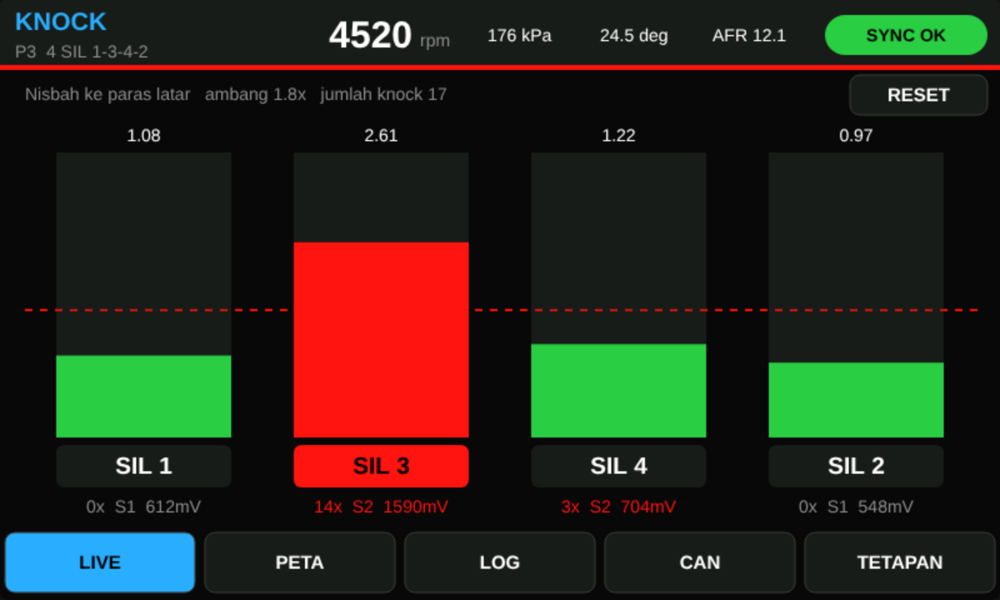
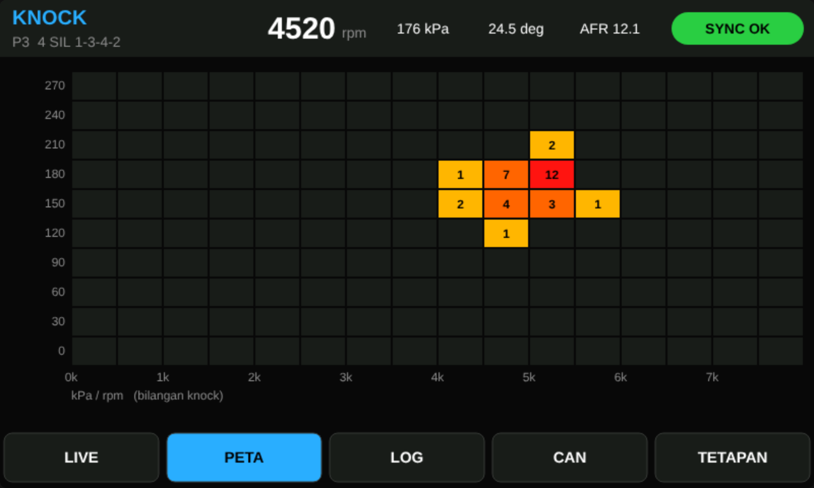
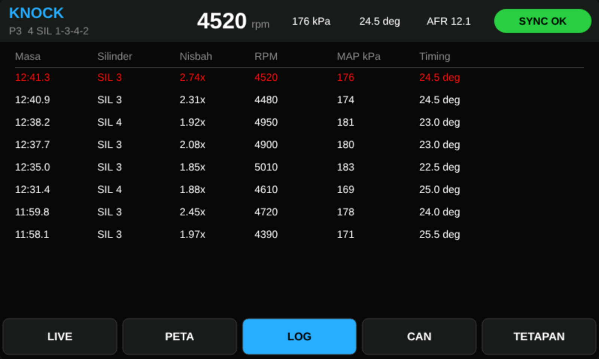
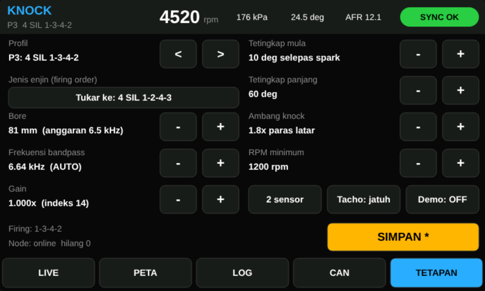
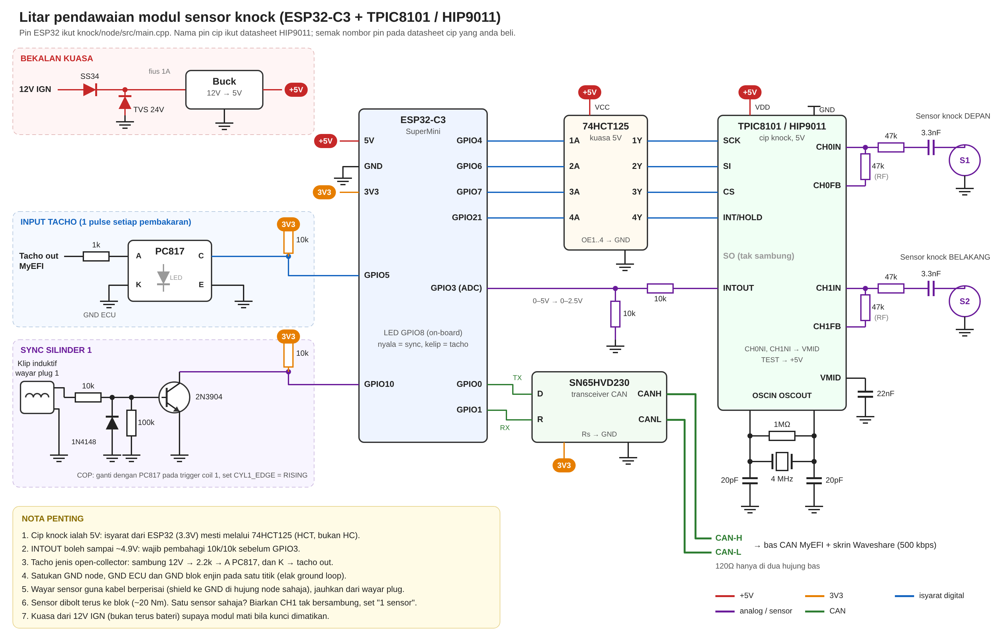

# Pengesan Knock Enjin (ESP32 + skrin 4.3")

Alat diagnostik untuk tuner: kesan knock dan tunjuk **silinder mana** yang knock, pada RPM dan MAP berapa. Satu alat boleh dipakai pada banyak enjin (3, 4, 5, 6 dan 8 silinder), dengan profil yang disimpan untuk setiap enjin.

## Gambaran skrin

| LIVE | PETA |
|---|---|
|  |  |
| **LOG** | **TETAPAN** |
|  |  |

Tab **CAN** ([gambar](docs/4-can.png)) menyenaraikan ID CAN yang dilihat untuk cari ID MyEFI. Gambar ni mockup dengan data contoh.

## Seni bina

```
 Sensor knock 1 (depan) ─┐
 Sensor knock 2 (belakang)┴─► TPIC8101/HIP9011 ─► ESP32-C3 "node" ──┐
 Tacho out MyEFI ───────────────── opto ────────►      │            │
 Klip induktif silinder 1 ───────── NPN ─────────►     │            │
                                                       CAN-H/CAN-L (bas yang sama)
 MyEFI (RPM, MAP, timing, AFR) ─────────────────────────┤            │
                                                       ▼            │
                                  Waveshare ESP32-S3-Touch-LCD-4.3 ◄┘
```

**Kenapa ada 2 bahagian?** Skrin RGB pada board Waveshare 4.3" guna hampir semua GPIO ESP32-S3. Yang tinggal tak cukup untuk SPI cip knock, INT/HOLD, tacho dan sync silinder 1. Jadi:
- **Node** (ESP32-C3, kecil, dipasang dekat enjin) uruskan semua kerja masa-nyata. Wayar analog sensor pun jadi pendek.
- **Skrin** cuma dengar bas CAN. Ia terima hasil dari node dan data dari MyEFI pada bas yang sama, guna transceiver CAN yang dah ada pada board.

## Cara silinder dikenal pasti
1. Setiap pulse **tacho** mewakili satu spark. Pada setiap pulse, node buka tetingkap integrasi bermula `winStart` darjah selepas spark, selama `winLen` darjah (lalai 10° + 60°). Darjah ditukar ke mikrosaat ikut RPM semasa.
2. Pulse **silinder 1** (klip induktif pada wayar plug 1, atau trigger coil 1) menetapkan bahawa pembakaran tu ialah indeks 0. Indeks seterusnya diikut mengikut **firing order** dalam profil.
3. Selepas tetingkap tamat, node baca voltan INTOUT (tenaga isyarat dalam band knock) dan hantar ke skrin.
4. Skrin belajar **paras latar** untuk setiap silinder. Kalau nisbah melebihi ambang (lalai 1.8x), ia direkod sebagai knock pada silinder tersebut.

Kalau enjin **wasted spark** dan klip dipasang pada wayar plug 1, pulse datang setiap pusingan. Node akan kesan keadaan ni sendiri, dan skrin tunjuk pasangan silinder (cth `1/4`, `3/2`). Untuk tahu silinder sebenar, guna trigger coil yang sequential atau perhatikan bacaan sensor depan/belakang.

## Senarai komponen

Senarai penuh dengan anggaran harga: [BOM.md](BOM.md)

| Komponen | Nota |
|---|---|
| Waveshare ESP32-S3-Touch-LCD-4.3 | Skrin 800×480, sentuh, CAN on-board |
| ESP32-C3 SuperMini | Node |
| TPIC8101DW atau HIP9011 | Cip knock 2 channel, **5V** |
| Kristal 4 MHz + 2× 20 pF + 1 MΩ | Jam cip knock (OSCIN/OSCOUT) |
| 74HCT125 (dikuasakan 5V) | Level shift 3.3V ke 5V untuk SCK, SI, CS, INT/HOLD |
| SN65HVD230 | Transceiver CAN untuk node |
| 2× sensor knock piezo OEM | Bosch atau yang setara |
| PC817 / 6N137 | Input tacho |
| 2N3904 + 1N4148 + perintang | Pemprosesan klip induktif silinder 1 |
| Buck 12V ke 5V + TVS 24V + diod polariti | Kuasa node dan skrin |

## Pendawaian node (ESP32-C3)



| ESP32-C3 | Ke |
|---|---|
| GPIO0 | SN65HVD230 D (TX) |
| GPIO1 | SN65HVD230 R (RX) |
| GPIO3 | INTOUT cip melalui pembahagi 10k/10k (5V ke 2.5V) |
| GPIO4 | 74HCT125 ke SCK cip |
| GPIO5 | Output optocoupler tacho (pull-up dalaman, aktif rendah) |
| GPIO6 | 74HCT125 ke SI cip |
| GPIO7 | 74HCT125 ke CS cip |
| GPIO10 | Output NPN klip silinder 1 (aktif rendah) |
| GPIO21 | 74HCT125 ke INT/HOLD cip |
| GPIO8 | LED: menyala = sync, berkelip = tacho tanpa sync |

**Cip knock (ikut datasheet HIP9011, Rajah 3 dan 4):**
- VDD 5V. VMID dinyahgandingkan dengan 22 nF ke GND. Pin TEST dibiarkan high.
- Setiap sensor: isyarat → 3.3 nF → 47k → CHxIN. Letak 47k antara CHxIN dan CHxFB (gain 1). Kalau isyarat lemah, naikkan RF.
- SO tidak diguna (firmware set high-Z). Hasil dibaca dari INTOUT melalui ADC.

**Input tacho:** Tacho MyEFI → 1k → LED PC817 → GND. Transistor PC817: collector ke GPIO5, emitter ke GND. Set MyEFI supaya keluarkan **satu pulse untuk setiap pembakaran** (4 silinder = 2 pulse setiap pusingan, 3 silinder = 1.5).

**Klip induktif silinder 1:** Klip → 10k → base 2N3904. Letak 1N4148 terbalik antara base dan emitter, dan 100k base ke emitter. Collector ke GPIO10, emitter ke GND. Untuk COP, back-probe wayar trigger coil 1 melalui PC817, kemudian tukar `CYL1_EDGE` ke `RISING` dalam `node/src/main.cpp`.

**CAN:** Sambung CAN-H dan CAN-L node dan skrin selari dengan bas MyEFI. Bas perlukan tepat **dua** perintang 120 Ω di hujung. Kalau MyEFI dah ada satu, letak satu lagi di hujung yang lain sahaja.

## Pemasangan sensor
- Bolt terus ke blok: guna lubang sensor knock OEM, atau stud M8/M10. Tork ikut spesifikasi sensor (biasanya 20 Nm). **Jangan guna magnet atau pelekat**.
- Sensor 1 di depan blok (antara silinder 1 dan 2), sensor 2 di belakang. Firmware pilih sensor terdekat untuk setiap silinder secara automatik (silinder separuh belakang guna sensor 2).

## Firmware

Kedua-duanya guna PlatformIO (Arduino, espressif32 6.9.0).

```
cd knock/node    && pio run -t upload    # ESP32-C3
cd knock/display && pio run -t upload    # Waveshare: guna port USB "UART"
```

> Pada skrin, firmware tukar GPIO19/20 ke transceiver CAN (`USB_SEL`). Jadi port USB native tak berfungsi semasa firmware berjalan. Muat naik dan konsol Serial guna port **UART**.

Ujian logik di PC:
```
cd knock/display/test && g++ -std=c++17 -I../src -I../../shared test_engine.cpp -o t && ./t
```

## Set isyarat CAN MyEFI
1. Pergi ke tab **CAN** pada skrin (atau guna app Aboy Canbus, tab Sniff) untuk tengok ID yang MyEFI siarkan.
2. Buka konsol Serial (port UART, 115200) dan masukkan ikut manual MyEFI, contohnya:
   ```
   sig rpm 0x5F0 0 2 be u 1 0
   sig map 0x5F0 2 2 be u 0.1 0
   sig adv 0x5F1 0 2 be s 0.1 0
   save
   ```
   ID di atas cuma contoh. Guna ID sebenar dari manual atau hasil sniff.
3. **Penting:** node guna ID `0x6E0`–`0x6E2`. Pastikan ID ni tak dipakai MyEFI. Kalau bertembung, tukar dalam `shared/knock_proto.h`. Kadar bit lalai ialah 500 kbps (`CAN_KBPS`).

## Langkah tuning di skrin
1. Pergi ke **TETAPAN**, pilih slot profil, kemudian tekan "Tukar ke" sampai jenis enjin yang betul (firing order). Set bore.
2. Frekuensi bandpass dikira automatik dari bore. Laraskan dengan `-`/`+` kalau perlu.
3. Hidupkan enjin. Status atas mesti tunjuk **SYNC OK**. Pada RPM tetap tanpa knock, bacaan mV ideal ialah 0.3–2.5 V. Laras **Gain** kalau terlalu rendah atau tepu.
4. Ambang lalai 1.8x. Turunkan untuk lebih sensitif, naikkan kalau ada knock palsu.
5. Tekan **SIMPAN**.
6. Semasa dyno atau jalan raya, tengok:
   - **LIVE** untuk bar setiap silinder
   - **PETA** untuk sel RPM × MAP yang knock
   - **LOG** untuk senarai event lengkap dengan timing

## Perkara yang belum disahkan pada hardware
- Firmware **belum dikompil dengan toolchain ESP32** dalam sesi ini (rangkaian menyekat muat turun). Logik utama dah diuji di PC, dan semua fail dah lulus semakan sintaks dengan stub header.
- Tahap `USB_SEL` untuk CAN (0) diambil dari projek CAN lain untuk board yang sama. Kalau CAN senyap, cuba tukar `USB_SEL_FOR_CAN` ke 1 dalam `display/src/board.h`.
- Sisi pulse tacho MyEFI (naik atau jatuh) boleh ditukar di TETAPAN.
- Ketepatan tetingkap bergantung pada pulse tacho berlaku hampir serentak dengan spark. Kalau MyEFI ada kelewatan pada tacho out, laraskan "Tetingkap mula".

## Keselamatan
Alat ni untuk diagnostik dan tuning sahaja. Ia **tidak** mengawal timing enjin. Kalau knock dikesan, kurangkan advance atau beban dalam MyEFI. Uji dahulu di dyno atau kawasan selamat.
